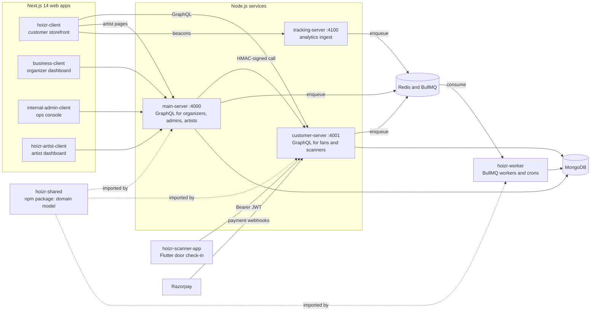

# Hoizr

**Ticketing, guest lists, fan CRM, marketing and door check-in for live events in India.**

Hoizr is a multi-service SaaS for venues, event organizers and artists. Fans buy tickets on [hoizr.com](https://hoizr.com), organizers run events from [business.hoizr.com](https://business.hoizr.com), and door staff check people in with a Flutter app that keeps working offline. The code lives in ten repositories: three Node.js services and a background worker that share one TypeScript domain-model package, four Next.js 14 web apps, and a mobile scanner.

**Start here:** [hoizr-walkthrough](https://github.com/roop37/hoizr-walkthrough) is a guided tour of the whole system, from architecture to local setup.

## Architecture

## Repositories

| Repository | What it is | Stack |
|---|---|---|
| [main-server](https://github.com/roop37/main-server) | GraphQL API for organizers, internal admins and artists | Fastify 5, Mercurius, TypeGraphQL, Typegoose, BullMQ |
| [customer-server](https://github.com/roop37/customer-server) | GraphQL API for fans and door scanners: cart, checkout, payment webhooks | Fastify 5, Mercurius, TypeGraphQL, Typegoose, Razorpay |
| [hoizr-worker](https://github.com/roop37/hoizr-worker) | Every async side effect: order finalisation, email, SMS, campaigns, scheduled jobs | BullMQ, node-cron, Nodemailer with Handlebars |
| [tracking-server](https://github.com/roop37/tracking-server) | Write-only analytics ingest that queues events for the workers | Fastify 5, BullMQ |
| [hoizr-shared](https://github.com/roop37/hoizr-shared) | `@hoizr-technology/shared`: domain model, enums, queue names, ledger helpers | TypeScript, Typegoose, TypeGraphQL |
| [hoizr-client](https://github.com/roop37/hoizr-client) | Customer storefront at hoizr.com | Next.js 14 App Router, Zustand, Tailwind CSS |
| [business-client](https://github.com/roop37/business-client) | Organizer and venue dashboard, plus the business.hoizr.com marketing site | Next.js 14 (Pages and App Router), shadcn/ui, Zustand |
| [internal-admin-client](https://github.com/roop37/internal-admin-client) | Internal operations console | Next.js 14 App Router, MUI, Tailwind CSS |
| [hoizr-artist-client](https://github.com/roop37/hoizr-artist-client) | Artist dashboard and editorial landing page | Next.js 14 App Router, Zustand, Tailwind CSS |
| [hoizr-scanner-app](https://github.com/roop37/hoizr-scanner-app) | Door check-in app with an offline mode | Flutter, mobile_scanner, sqflite |

## Engineering highlights

- **Idempotent payment webhooks:** the route checks the HMAC and queues the raw body ([route](https://github.com/roop37/customer-server/blob/main/src/routes/razorpay-webhook.route.ts)); the worker skips any event it has already processed ([worker](https://github.com/roop37/hoizr-worker/blob/main/src/workers/razorpay-webhook/razorpay-webhook.process.ts)).
- **Atomic cart inventory:** one Redis Lua script reserves a cart's holds across ticket types all-or-nothing, so concurrent carts cannot over-reserve ([redis.ts](https://github.com/roop37/customer-server/blob/main/src/utils/redis.ts)).
- **Double-entry ledger in paise:** every transaction must balance and carries an idempotency key ([post-transaction.ts](https://github.com/roop37/hoizr-shared/blob/main/src/ledger/post-transaction.ts)).
- **Single-flight crons:** each scheduled tick claims a Redis `SET NX` lock, so only one worker replica runs it ([cron.scheduler.ts](https://github.com/roop37/hoizr-worker/blob/main/src/workers/crons/cron.scheduler.ts)).
- **Signed service-to-service calls:** HMAC over timestamp and raw body, and stale timestamps are rejected ([internal-auth.ts](https://github.com/roop37/hoizr-shared/blob/main/src/utils/internal-auth.ts)).
- **Offline door check-in:** the scanner caches the event's ticket manifest in SQLite and syncs queued scans later ([offline_store.dart](https://github.com/roop37/hoizr-scanner-app/blob/main/lib/services/offline_store.dart)).

## Contributing

Contributions are welcome. Read the [contributing guide](https://github.com/roop37/hoizr-dotgithub/blob/main/CONTRIBUTING.md) and the [code of conduct](https://github.com/roop37/hoizr-dotgithub/blob/main/CODE_OF_CONDUCT.md). Report security issues privately as described in the [security policy](https://github.com/roop37/hoizr-dotgithub/blob/main/SECURITY.md).

## Credits and license

Built by [@roop37](https://github.com/roop37).

Hoizr is open source under the [MIT License](https://github.com/roop37/hoizr-dotgithub/blob/main/LICENSE). See the `LICENSE` file in each repository.
